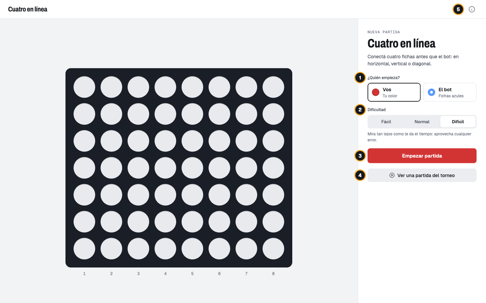
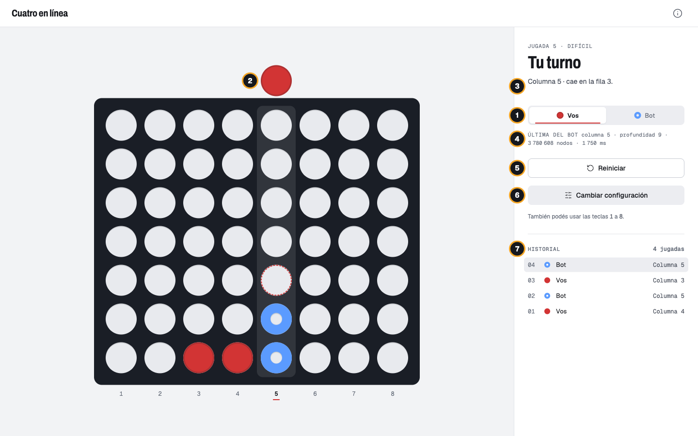
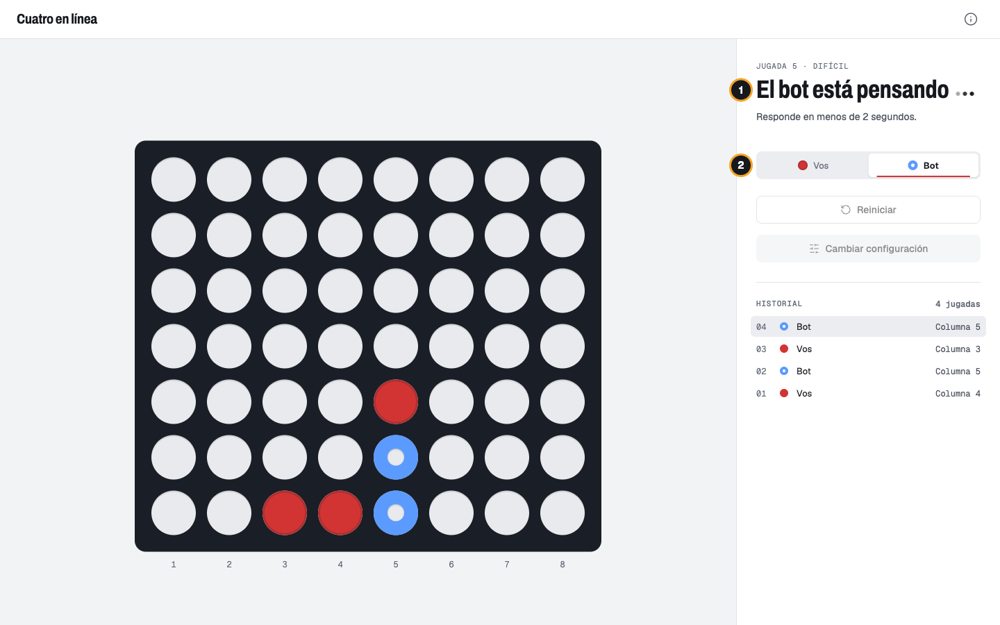
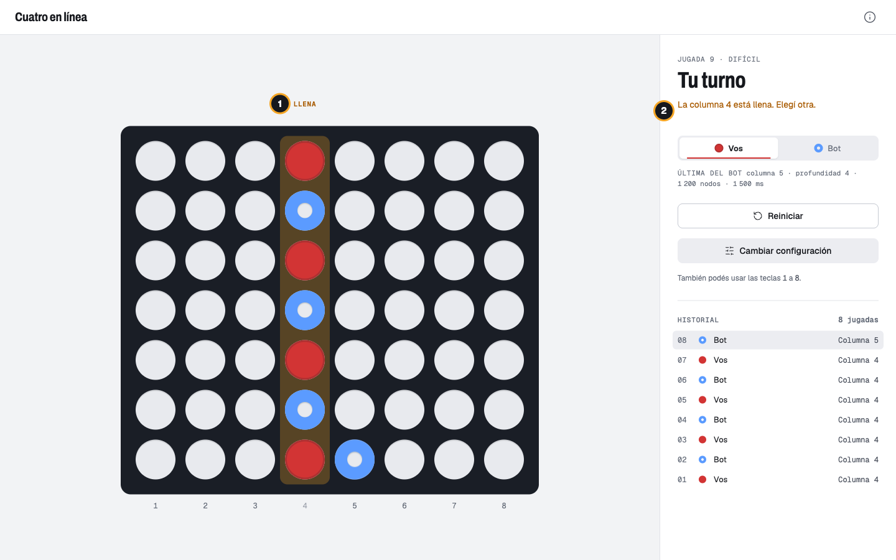
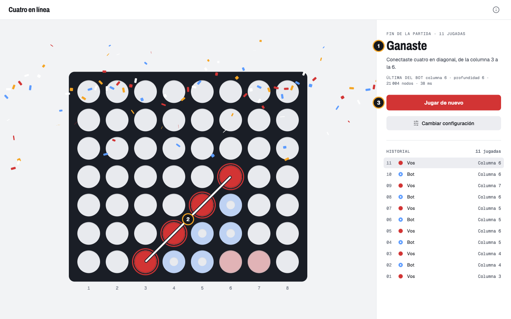
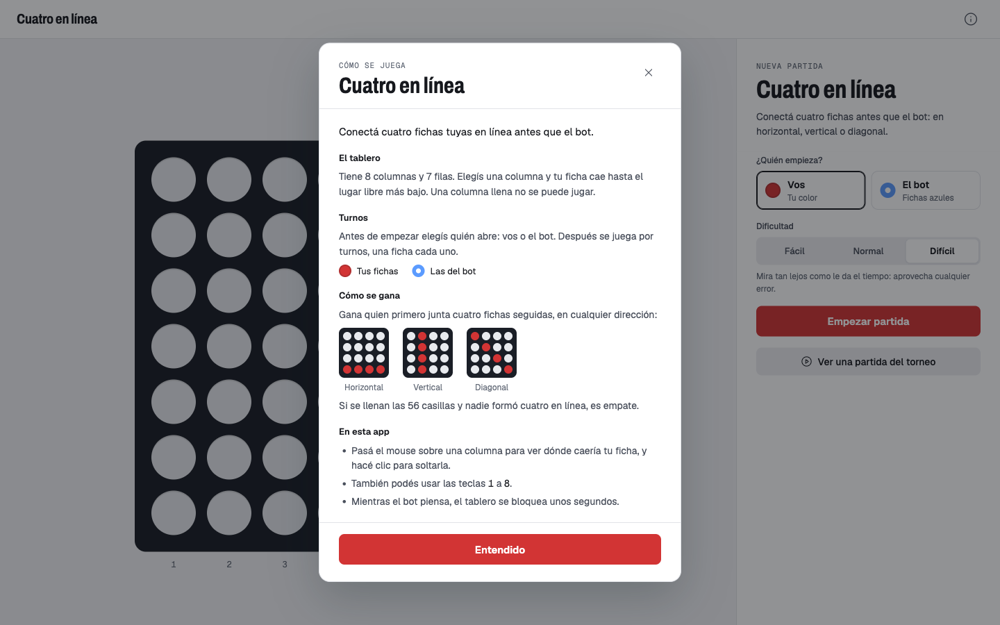
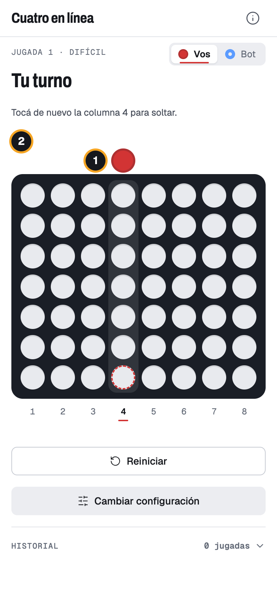
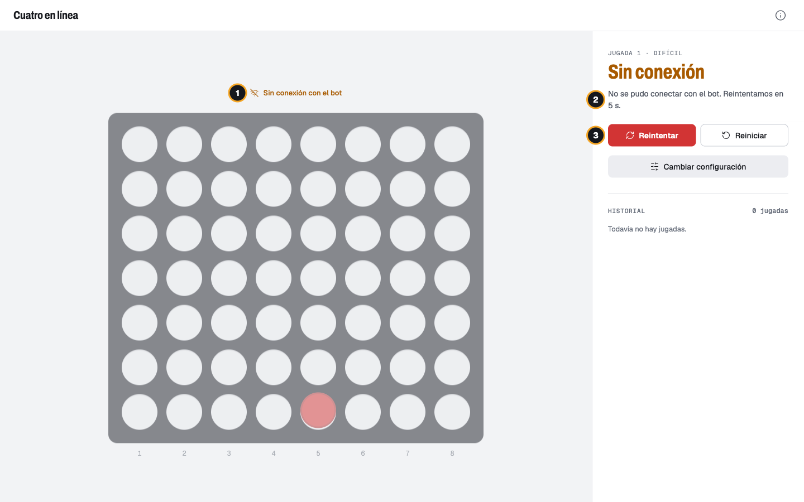
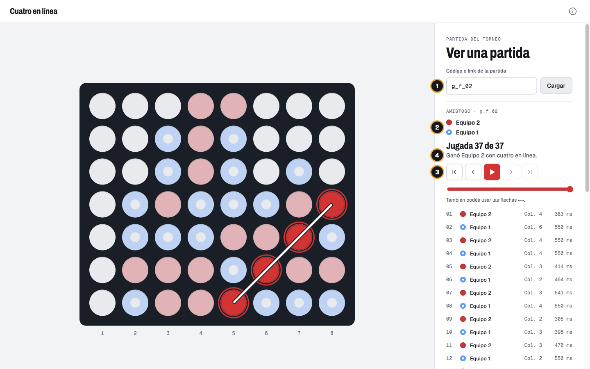

# Manual de uso — Cuatro en línea

Este manual explica cómo jugar contra el bot del Equipo 3 desde la computadora o el teléfono. No hace falta saber programar.

## Qué es

Cuatro en línea es un juego para dos: cada uno, en su turno, suelta una ficha en una de las 8 columnas de un tablero vertical. La ficha cae hasta el lugar libre más bajo. **Gana quien primero junta cuatro fichas seguidas**, en horizontal, vertical o diagonal.

En esta app jugás vos contra un bot. Es el mismo programa que compite en el torneo del challenge.

- Tus fichas son **discos llenos** (rojos).
- Las del bot son **azules con el centro hueco**.

Se distinguen por la forma, además del color, así que también se reconocen con daltonismo.

## Cómo abrirla

Pedile a quien instaló la app la dirección para entrar y abrila en el navegador (Chrome, Edge, Safari o Firefox):

- En la misma computadora: `http://localhost:4200`
- Desde otro dispositivo de la misma red (por ejemplo, tu teléfono): `http://` seguido de la dirección de esa computadora y `:4200`, por ejemplo `http://192.168.0.20:4200`.

> **Para quien instala la app.** Hacen falta dos programas corriendo en la computadora:
>
> 1. El bot: `cd bot && go run ./cmd/bot` (queda escuchando en el puerto 3000).
> 2. La app: la primera vez, `npm --prefix web install`. Después, `npm run dev:web` para usarla solo en esa computadora, o `npm --prefix web run start:lan` para abrirla también desde teléfonos y otras computadoras de la red.
>
> El detalle técnico está en el README del repositorio.

## 1. Pantalla de inicio

1. **¿Quién empieza?** Elegí si abrís vos o el bot.
2. **Dificultad.** Elegí entre tres niveles. Debajo de los botones aparece qué hace el bot en cada uno:
   - **Fácil:** mira 2 jugadas adelante. Gana y bloquea lo inmediato.
   - **Normal:** mira 6 jugadas adelante. Se le puede ganar planificando.
   - **Difícil** (viene elegido): mira tan lejos como le da el tiempo y aprovecha cualquier error.
3. **Empezar partida.** Arranca el juego. Si elegiste que abra el bot, primero lo vas a ver pensar y después aparece su ficha.
4. **Ver una partida del torneo.** Abre la reproducción de una partida que jugó el bot contra otro equipo (ver la sección 9).
5. **Cómo se juega.** Abre las reglas en cualquier momento (ver la sección 6).

## 2. Tu turno

Cuando el título dice **Tu turno**, podés jugar:

- **Con el mouse:** pasá el puntero sobre una columna para ver dónde caería tu ficha, y hacé clic para soltarla.
- **Con el teclado:** las teclas **1** a **8** sueltan la ficha en esa columna.

Qué significa cada cosa:

1. **Indicador de turno.** Marca a quién le toca: a vos (Vos) o al bot (Bot).
2. **Vista previa.** Arriba del tablero aparece tu ficha sobre la columna elegida. Abajo, un círculo punteado muestra el lugar exacto donde va a caer.
3. **Ayuda.** Indica la columna y la fila donde caería tu ficha.
4. **Última jugada del bot.** Dato informativo: en qué columna jugó, hasta cuántas jugadas adelante miró y cuánto tardó. No hace falta para jugar.
5. **Reiniciar.** Empieza una partida nueva con la misma configuración.
6. **Cambiar configuración.** Vuelve a la pantalla de inicio para elegir de nuevo quién empieza y la dificultad. Como la partida en curso se pierde, antes pregunta: **Seguir jugando** (o la tecla Esc) cancela y **Volver al inicio** confirma. Mientras el bot piensa, este botón espera a que responda.
7. **Historial.** Todas las jugadas, de la más reciente a la primera, con quién jugó y en qué columna.

## 3. El bot está pensando

Después de tu jugada, tu ficha cae y el bot calcula su respuesta.

1. El título dice **El bot está pensando**, con tres puntos que se mueven. Puede tardar hasta unos 2 segundos.
2. El indicador pasa a **Bot**.

Mientras tanto el tablero no responde. Cuando el bot juega, su ficha cae y vuelve a ser tu turno.

## 4. Columna llena

Una columna con 7 fichas ya no admite más.

1. Arriba de la columna aparece **LLENA** y su número se ve más claro.
2. Si igual la elegís, la columna tiembla y la ayuda lo explica: "La columna 4 está llena. Elegí otra.". No se pierde el turno: elegí otra columna.

## 5. Fin de la partida

1. **El resultado.**
   - Si ganás, el título dice **Ganaste** y cae confeti.
   - Si gana el bot, dice **Ganó el bot**.
   - Debajo se explica la línea ganadora, por ejemplo "Conectaste cuatro en diagonal, de la columna 3 a la 6.".
2. **La línea ganadora.** Las cuatro fichas quedan marcadas con un anillo y unidas con una línea blanca. Las demás fichas se atenúan.
3. **Jugar de nuevo** arranca otra partida con la misma configuración. **Cambiar configuración** vuelve a la pantalla de inicio.

Si se llenan las 56 casillas sin que nadie forme cuatro en línea, el título dice **Empate**.

## 6. Reglas dentro de la app

El botón **ⓘ** de arriba a la derecha abre un resumen de las reglas con ejemplos de las tres formas de ganar. Se cierra con **Entendido**, con la **×**, tocando afuera del recuadro o con la tecla Esc. Mientras está abierto, el tablero no responde: no se juega nada sin querer.

## 7. En el teléfono

En el teléfono todo se ve en una sola columna: el estado arriba, el tablero en el medio y los botones abajo. Para jugar se usan **dos toques**, así no se suelta una ficha por error:

1. **Primer toque** en una columna: muestra tu ficha arriba y el lugar donde caería.
2. **Segundo toque** en la misma columna: la suelta. La ayuda lo recuerda: "Tocá de nuevo la columna 4 para soltar.".

Si tocás otra columna, la vista previa se mueve ahí. El historial está plegado al final de la pantalla: tocalo para verlo.

## 8. Si algo falla

### Sin conexión con el bot

Si la app no puede comunicarse con el bot (por ejemplo, porque se cerró el programa del bot):

1. Arriba del tablero aparece **Sin conexión con el bot** y el tablero se ve más apagado.
2. La app vuelve a intentar sola cada 5 segundos y muestra la cuenta regresiva.
3. **Reintentar** prueba en ese momento. **Reiniciar** empieza otra partida y **Cambiar configuración** vuelve al inicio.

Tu última ficha se sigue viendo mientras tanto. Cuando vuelve la conexión, la app revisa si la jugada llegó al bot antes de reenviarla, así que nunca se juega dos veces.

### "La partida ya no existe"

Si el bot se reinició, se pierden las partidas que estaban en curso. La app lo avisa con este mensaje. Tocá **Jugar de nuevo** para empezar otra.

## 9. Ver una partida del torneo

Desde la pantalla de inicio, **Ver una partida del torneo** abre la reproducción de cualquier partida que haya jugado el bot contra otro equipo.

1. **Cargá la partida.** Escribí su código (por ejemplo `g_7f3a`) o pegá un link que lo contenga (como `…/games/g_7f3a`), y tocá **Cargar**.
2. **Mirá los equipos.** Aparecen los dos equipos con el color de sus fichas: el que abrió con fichas llenas y el otro con fichas huecas.
3. **Recorré la partida.**
   - Con los botones podés ir al inicio, retroceder, reproducir o pausar, avanzar e ir al final.
   - La barra salta a cualquier jugada, y con el teclado las flechas **←** y **→** pasan de a una.
   - En la lista de jugadas, tocá una para ir directo a ella. Al lado de cada jugada se ve cuánto tardó ese bot en decidir.
4. **Al final** aparece cómo terminó y, si fue con cuatro en línea, se marca la línea ganadora.

Mientras se reproduce no se puede jugar en el tablero. **Volver a jugar contra el bot** regresa al inicio.

## Preguntas frecuentes

**¿Puedo deshacer una jugada?**
No, por ahora no.

**¿Por qué a veces el bot tarda y otras responde enseguida?**
Depende de la dificultad. En Fácil y Normal responde casi al instante. En Difícil usa todo el tiempo que tiene, hasta unos 2 segundos.

**¿Qué son los números de "Última del bot"?**
Muestran cómo pensó el bot su última jugada: cuántas jugadas adelante miró ("profundidad"), cuántas posiciones revisó ("nodos") y cuánto tardó. Son informativos.

**¿Qué significa la etiqueta "BOT SIMULADO (DEMO)" arriba?**
Que la app está en un modo de prueba, con un bot que no razona ni corta la partida con cuatro en línea. Aparece solo si la dirección termina en `?scenario=…`. Para jugar contra el bot real, abrí la dirección sin esa parte.

**¿Puedo jugar desde el teléfono?**
Sí, si el teléfono está en la misma red que la computadora donde corre la app (ver "Cómo abrirla").
